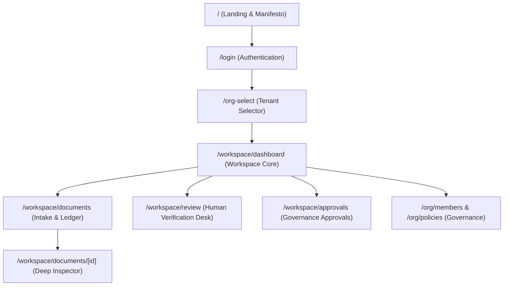

# Kagaz Frontend Design System & Wireframes Architecture

**Document Version:** 2.0.0  
**Scope:** Complete Frontend Visual Overhaul, Design System, Motion Choreography & Wireframe Specifications  
**Status:** Approved Specification  

---

## 1. Executive Summary & Design Vision

Kagaz is an archival document intelligence, classification, and verification platform that transforms unstructured PDFs and scanned images into deterministic business assets. 

### From "Flat Paper Ledger" to "Intelligent Document OS"
The legacy frontend suffered from:
- A stark, flat `#FFFFFF` canvas with `#EAEAEA` borders that caused eye strain and lacked visual depth and structural hierarchy.
- Low-contrast typography (`#888888` and `#A1A1A1`) that failed WCAG accessibility standards on metadata and secondary captions.
- Monochromatic, static interfaces devoid of motion feedback, micro-interactions, or spatial depth.
- Inflexible icon styling that remained greyish-brown even during active or hover states.

The **Overhauled Design Language** establishes a modern, sleek, minimal, and high-performance design system inspired by modern developer platforms and fintech intelligence tools (Linear, Stripe, Vercel):
1. **Luminous Minimalist Canvas**: A serene slate-50 (`#F8FAFC`) background accented with subtle ambient radial gradients and crisp, elevated white card surfaces (`#FFFFFF`) with multi-layered micro-shadows.
2. **Crystal-Clear Legibility**: Ultra-high-contrast slate typography (`#0F172A` / `#1E293B`) delivering WCAG AAA-compliant 16:1 contrast ratios.
3. **Electric Brand Presence**: An electric indigo & violet accent system (`#4F46E5`, `#6366F1`) paired with vivid semantic indicators (Emerald, Amber, Crimson, Sky).
4. **Rich Motion & Tactile Physics**: Smooth spring-based transitions (`cubic-bezier(0.16, 1, 0.3, 1)`), shimmer loading states, pulse glow halos on active records, animated dash marches on drag zones, and tactile button compressions.

---

## 2. Design Tokens & Color Architecture

### 2.1 Surfaces & Layers
| Token | Value | Description |
|---|---|---|
| `--bg` | `#F8FAFC` | Global ambient canvas (Slate-50) |
| `--canvas` | `#FFFFFF` | Primary card and workspace surface |
| `--surface` | `#FFFFFF` | Standard elevated container |
| `--surface-secondary` | `#F1F5F9` | Secondary recessed container (Slate-100) |
| `--surface-sidebar` | `#0B0F19` | Premium dark obsidian sidebar with glass blur |
| `--sidebar-hover` | `rgba(255, 255, 255, 0.06)` | Hover state in navigation items |
| `--sidebar-active` | `rgba(99, 102, 241, 0.15)` | Active navigation background with soft glow |

### 2.2 Typography & Contrast Matrix
| Token | Color | Contrast Ratio vs White | WCAG Status | Purpose |
|---|---|---|---|---|
| `--ink` | `#0F172A` | **16.5 : 1** | **AAA** Pass | Primary headings, document titles, bold labels |
| `--body` | `#1E293B` | **13.8 : 1** | **AAA** Pass | Body paragraphs, tabular cell data, form values |
| `--secondary` | `#334155` | **9.6 : 1** | **AAA** Pass | Secondary details, metadata descriptions |
| `--muted` | `#475569` | **7.1 : 1** | **AAA** Pass | Micro-labels, timestamps, section subtitles |
| `--faint` | `#64748B` | **4.9 : 1** | **AA** Pass | Subtle helper notes, breadcrumb separators |
| `--placeholder` | `#94A3B8` | **3.2 : 1** | AA Large | Input placeholders |

### 2.3 Brand & Semantic Tokens
- **Brand Primary**: Electric Indigo `#4F46E5` (Hover: `#4338CA`, Active: `#3730A3`)
- **Brand Glow**: `rgba(79, 70, 229, 0.25)`
- **Brand Surface**: `#EEF2FF` (Border: `#C7D2FE`)
- **Success (Pass / Approved)**: `#059669` (Surface: `#ECFDF5`, Border: `#A7F3D0`)
- **Warning (Review / Flag)**: `#D97706` (Surface: `#FFFBEB`, Border: `#FDE68A`)
- **Error (Fail / Rejected)**: `#DC2626` (Surface: `#FEF2F2`, Border: `#FECACA`)
- **Info (Processing / Blue)**: `#0284C7` (Surface: `#F0F9FF`, Border: `#BAE6FD`)
- **Violet (Classification)**: `#7C3AED` (Surface: `#F5F3FF`, Border: `#DDD6FE`)

---

## 3. Motion Choreography & Micro-Interactions

Every interaction provides immediate visual feedback through physics-based easing:

```css
:root {
  --ease-spring: cubic-bezier(0.16, 1, 0.3, 1);
  --ease-smooth: cubic-bezier(0.4, 0, 0.2, 1);
  --transition-fast: 150ms var(--ease-spring);
  --transition-normal: 250ms var(--ease-spring);
  --transition-slow: 400ms var(--ease-smooth);
}
```

### Motion Primitives:
1. **Interactive Lift**: All cards lift `translateY(-2px)` on hover with expanding dual-layer shadows.
2. **Tactile Button Press**: Interactive buttons scale down `scale(0.97)` on `:active`, returning with snappy spring dampening.
3. **Pulse Glow Halos**: Online backend status, unread notification dots, and live queue badges feature a soft ambient breathing ring (`@keyframes pulseGlow`).
4. **Intake Dash March**: The upload dropzone animates dashed border lines continuously on dragover (`@keyframes marchDashes`).
5. **Drawer & Modal Staging**: Sheets glide smoothly from the right edge with a backdrop blur veil (`backdrop-filter: blur(8px)`).
6. **Shimmer Skeletons**: Skeleton loaders sweep a 45-degree luminous gradient to indicate asynchronous ingestion.

---

## 4. Architectural Wireframes & View Specifications



---

### Wireframe 1: Landing Page & Public Manifesto (`/`)

```
+-----------------------------------------------------------------------------------------+
| [Kagaz.]                                    Manifesto   Open Workspace   [● Aryan Patel]|
+-----------------------------------------------------------------------------------------+
|  § 00 · ARCHIVAL DOCUMENT INTELLIGENCE                                                  |
|                                                                                         |
|  From unstructured files to                 SPEC: PDF · PNG · JPG · TAXONOMY V2.4       |
|  *clearer workflows.*                       10 MB CEILING · PRIVATE CLOUD ENCLAVE       |
|                                                                                         |
|  Kagaz ingests corporate filings, extracts structured key-value schemas, classifies     |
|  genres via deterministic AI, and powers automated policy governance loops.             |
|                                                                                         |
|  [ Deposit File into Intake ↥ ]  [ Human Verification Queue → ]  [ Sign In to Workspace ]|
+-----------------------------------------------------------------------------------------+
|  +-------------------------+ +-------------------------+ +-------------------------+     |
|  | 01 · INGESTION          | | 02 · TAXONOMY           | | 03 · VERIFICATION       |     |
|  | Strict File Intake      | | Deterministic AI Rules  | | Reviewer Override Desk  |     |
|  | Multi-page OCR & text   | | 8 Document Categories   | | Audit-logged decisions  |     |
|  | [Test Intake →]         | | [Open Repository →]     | | [Launch Review →]       |     |
|  +-------------------------+ +-------------------------+ +-------------------------+     |
+-----------------------------------------------------------------------------------------+
|  "Classification is derived from document structure, legal covenants, and semantic     |
|   markers — not filename alone."               — Kagaz Archival Standard · Rule 12.B    |
+-----------------------------------------------------------------------------------------+
|  ACTIVE ARCHIVAL LEDGER                                                                 |
|  [#01] invoice_acme_q3.pdf    [doc_84920]   2026-11-23   Commercial Invoice   [Inspect] |
|  [#02] employment_offer.pdf   [doc_91823]   2026-11-23   HR Record            [Inspect] |
+-----------------------------------------------------------------------------------------+
```

---

### Wireframe 2: Global Workspace Shell & Interactive Sidebar (`/workspace/*`)

```
+----------+------------------------------------------------------------------------------+
| [Kagaz.] |  Workspace / Intake & Library                              [Bell (2)] [Aryan]|
| [Org ▾]  +------------------------------------------------------------------------------+
|          |  [ + Dropzone: Deposit PDF / Scanned Record ]                                |
| • Overvw |  +--------------------------------------------------------------------------+|
| • Files  |  |   ↥ Drag & drop enterprise documents here or [ Browse Local Files ]      ||
| • Review |  |   Supported: PDF, PNG, JPG, JPEG · Max 10 MB · Realtime OCR & Validation  ||
| • Apprvs |  +--------------------------------------------------------------------------+|
|          |                                                                              |
| PLATFORM |  Search: [ Filter records...      ]   Genre: [ All | Invoice | HR | Legal ]  |
| • Org    |  +--------------------------------------------------------------------------+|
| • Policy |  | FILE NAME         | ID         | DATE       | GENRE       | CONF | STATUS  ||
|          |  |-------------------|------------|------------|-------------|------|---------||
| [Online] |  | invoice_304.pdf   | doc_30491  | Nov 23     | Invoice     | 98%  | [PASS]  ||
| [Aryan P]|  | master_saas.pdf   | doc_99182  | Nov 22     | Contract    | 94%  | [REVIEW]||
+----------+--+--------------------------------------------------------------------------++
```

---

### Wireframe 3: Deep Document Inspector (`/workspace/documents/[id]`)

```
+-----------------------------------------------------------------------------------------+
| Library / Commercial Invoice / invoice_october.pdf                 [ ⌂ Private Enclave ]|
|                                                                                         |
| [📄] invoice_october.pdf                                                                |
|      doc_92841 [Copy] · 2.4 MB · Uploaded Nov 24, 2026                 [ VALIDATED ]    |
|                                                                                         |
|      CLASSIFIED AS Commercial Invoice (98.4% Confidence)                                |
|      [ Re-run Extraction ↻ ]   [ Correct Classification ✎ ]                             |
+-----------------------------------------------------------------------------------------+
| [ Overview & Fields ]  [ Policy Validation (3) ]  [ Audit Trail ]  [ Policy Assistant ] |
+-----------------------------------------------------------------------------------------+
|  +---------------------------------------+  +----------------------------------------+  |
|  | DOCUMENT STAGE PREVIEW                |  | EXTRACTED SCHEMA & ATTRIBUTES          |  |
|  | +-----------------------------------+ |  | Supplier: Apex Technologies LLC        |  |
|  | | INVOICE # INV-2026-89             | |  | Total: $14,250.00 (USD)                |  |
|  | | Billed To: Kagaz Global           | |  | Invoice Date: 2026-11-20               |  |
|  | | Due: 30 Days Net                  | |  | Tax ID / VAT: US-94820184             |  |
|  | | Total: $14,250.00 [Validated]     | |  | Line Items: 3 Identified Items         |  |
|  | +-----------------------------------+ |  | OCR Text: 1,482 characters parsed      |  |
|  +---------------------------------------+  +----------------------------------------+  |
+-----------------------------------------------------------------------------------------+
```

---

### Wireframe 4: Policy Validation Tab (`/workspace/documents/[id]`)

```
+-----------------------------------------------------------------------------------------+
| POLICY VALIDATION RUN                                                      [ PASS (2/2) ]|
| Evaluated against 2 active governance policies (Finance Standard v2.1, Vendor Rule 4)   |
| [ Run Policy Validation 🛡️ ]                                                            |
+-----------------------------------------------------------------------------------------+
|  [ PASS ] Rule 101: Tax ID & Business Registration Present                              |
|           Finding: Vendor VAT verified against active IRS registry.                     |
|                                                                                         |
|  [ PASS ] Rule 104: Payment Threshold Approval Scope                                    |
|           Finding: Total ($14,250.00) is within standard single-signer threshold.       |
|                                                                                         |
|  [ FLAG ] Rule 208: Net Terms Adherence (Needs Review)                                  |
|           Finding: Detected 'Due upon receipt', organizational policy recommends Net 30.|
+-----------------------------------------------------------------------------------------+
```

---

### Wireframe 5: Verification Desk & Approvals Ledger (`/workspace/review`)

```
+-----------------------------------+-----------------------------------------------------+
| PENDING VERIFICATION (4)          | RECORD: vendor_contract_renew.pdf                   |
| Filter: [ All | Review | Low ]    | ID: doc_77182 · Uploaded by legal_dept              |
|                                   +-----------------------------------------------------+
| [!] vendor_contract_renew.pdf     | AI CLASSIFICATION: Legal Contract (71.2% - LOW)     |
|     71.2% Conf · Legal Contract   | Routing: Legal Compliance Queue                     |
|                                   +-----------------------------------------------------+
| [✓] hardware_invoice_49.pdf       | EXTRACTED ENTITY CHECK                              |
|     96.4% Conf · Invoice          | • Counterparty: "Cloud Infrastructure Inc"          |
|                                   | • Liability Cap: "12x Monthly Fees"                 |
| [✓] candidate_resume_aj.pdf       | • Term Length: "36 Months" [Review Required]        |
|     94.0% Conf · HR Record        +-----------------------------------------------------+
|                                   | ACTIONS:                                            |
|                                   | [ Approve & Certify ✓ ]  [ Request Changes ⚑ ]      |
|                                   | [ Add Audit Note ✎ ]     [ Open Full Inspector ↗ ]  |
+-----------------------------------+-----------------------------------------------------+
```

---

## 5. Visual Bug Fixes & UX Enhancements

1. **Text Contrast Elevation**: Replaced low-contrast `#666666`, `#888888`, and `#A1A1A1` with crisp Slate `#0F172A`, `#1E293B`, `#334155`, and `#475569`.
2. **Dynamic Icon Theming**: Replaced static raster/monochrome icon references with inline vector SVGs that automatically inherit parent font color (`stroke="currentColor"`).
3. **Sidebar Modernization**: Upgraded the sidebar into an obsidian-toned navigation surface with collapsible states, notification count badges with glowing auras, and clean typography.
4. **Interactive Hover Feedback**: Every table row, button, card, and tab now features spring-eased micro-transitions and hover states.
5. **Dropzone State Animation**: Added interactive visual states (drag-over glow, dashed border parade, format pills).
6. **Modal & Sheet Polish**: Backdrop blur filter, click-outside dismissal, escape key handling, and smooth slide-over drawer transitions.

---

*This document serves as the design and engineering standard for the Kagaz Frontend.*
